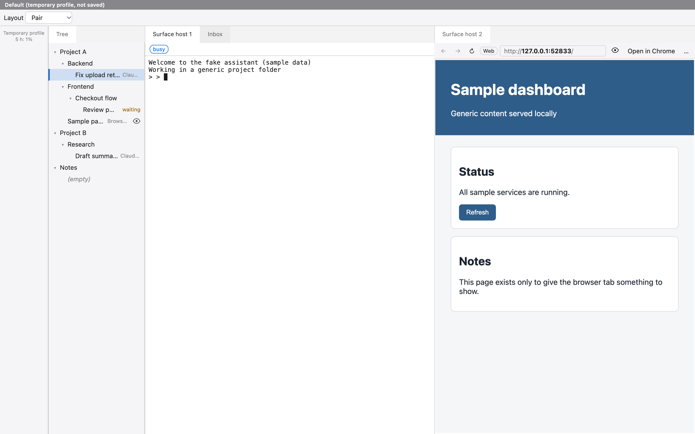

# Agide

Agide is a desktop tool for agentic coding on macOS. A tree of folders holds Claude sessions and browser tabs today, and Slack threads and other surfaces later. The app hosts an MCP server, so an agent can do what the UI does, and the UI is meant to show what agents are doing and when they need the user.

## Status

Early prototype. These parts work:

- The tree (nested folders, drag and drop, persistence).
- Claude sessions in a terminal with resume, launched through an isolation provider that runs `claude` on the host.
- The app MCP server with a UI and MCP parity check.
- A window built from a layout file that the user or an agent edits, with presets, undo and window capture.
- An inbox of items from Claude hooks and from agents, with notifications, a dock badge, tasks and recurring reminders.
- Profiles that run side by side, each with its own data, Claude login and tool credentials, with a switcher rail and unread badges.
- A permission mode per profile and per session, auto by default, with ask rules for outward-facing actions, a hook that inspects every tool call, an optional Bash sandbox with a network allowlist, and denials and approvals in the inbox.
- Browser tabs as tree leaves with a partition per service, browser tools for agents under the Claude in Chrome names, and observation that only the user switches on, with an access log and masks in window captures.
- Agent nodes under each session with state, history and read-only transcripts, and usage views: ranking, heat markers, plan usage and alerts.
- Task start from a prompt, a GitHub pull request (in a git worktree) or a Jira key.
- Isolation providers for Anthropic's sandbox runtime (srt) and, not yet offered for real sessions, a Docker container.
- Swarms: a group of agents started by the user from a dialog or by an agent through the MCP server, each a `claude -p` stream-json process with its own tier, budget and workspace (a git worktree, a read-only worktree or a scratch directory); a profile-wide cap with a queue, stages, steering and stopping per agent and per group, approvals answered from the inbox card, and a swarm pane with a budget meter.
- Themes as data: a System theme that follows the macOS appearance and accent, Agide Light and Agide Dark, ports of GitHub Dark Default and Catppuccin Mocha, import of VS Code themes from a file, and theme commands that agents can call too.

Layered review, the Slack surface, notes, apps, the OpenShell provider and user-written blocks are designed in the decision records and not built yet. Swarms do not merge their changes into a user branch; that waits for layered review. The tests run the app with a hidden window. `pnpm visual-check` in `app/` captures the UI states on sample data; the first on-screen check, its fixes and what is still not looked at in a visible window are in `docs/decisions/0031-on-screen-check-results.md`. The visual design system is `docs/decisions/0035-visual-design-system.md`, and what the restyle built and verified is in `docs/decisions/0036-restyle-results.md`. `docs/decisions/0014-milestone-1-results.md`, `docs/decisions/0024-milestone-2-results.md`, `docs/decisions/0030-milestone-3-results.md` and `docs/decisions/0039-milestone-4-results.md` list what exists and what was verified.

Continuous integration runs the typecheck, the unit tests with coverage thresholds, the end-to-end tests and the UI and MCP parity check on every pull request and on every push to `main`.

## Repository

| Path | Content |
|---|---|
| `app/` | The Electron application. `app/README.md` covers install, run and tests. |
| `docs/` | Decision records, the spike plan and an index (`docs/README.md`). |
| `notes/` | Research and review notes behind the records. |
| `probes/` | Scripts that test how the `claude` CLI behaves, and their results. |

## License

Apache License 2.0. See `LICENSE` and `NOTICE`.
